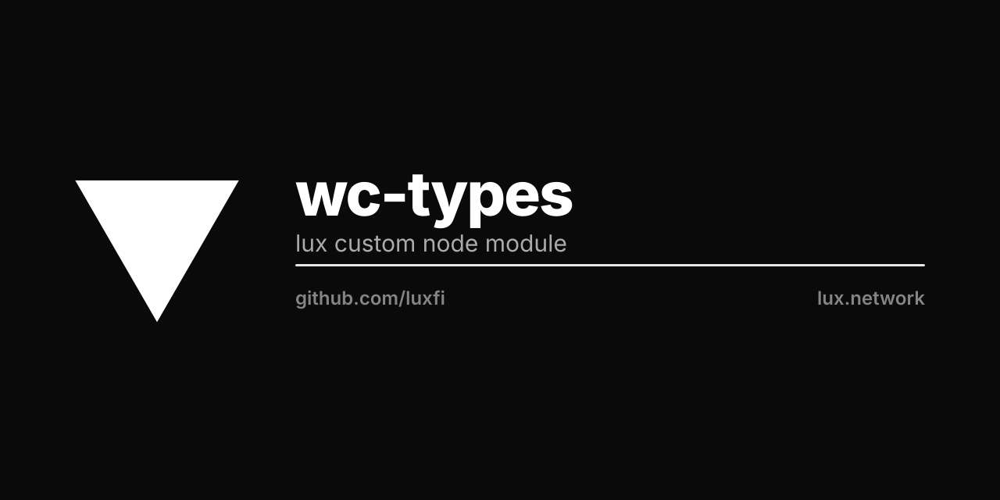

# WalletConnect Types

Typescript Types for WalletConnect

## Types

- ICryptoLib
- ISessionStorage
- IEncryptionPayload
- ISocketMessage
- ISessionStatus
- ISessionError
- IInternalEvent
- ICallTxData
- ITxData
- IJsonRpcResponseSuccess
- IJsonRpcErrorMessage
- IJsonRpcResponseError
- IJsonRpcRequest
- IWeb3Provider
- IClientMeta
- IEventEmitter
- IRequiredParamsResult
- IQueryParamsResult
- IParseURIResult
- ISessionParams
- IWalletConnectSession
- IWalletConnectOptions
- IPushServerOptions
- INativeWalletOptions
- IPushSubscription
